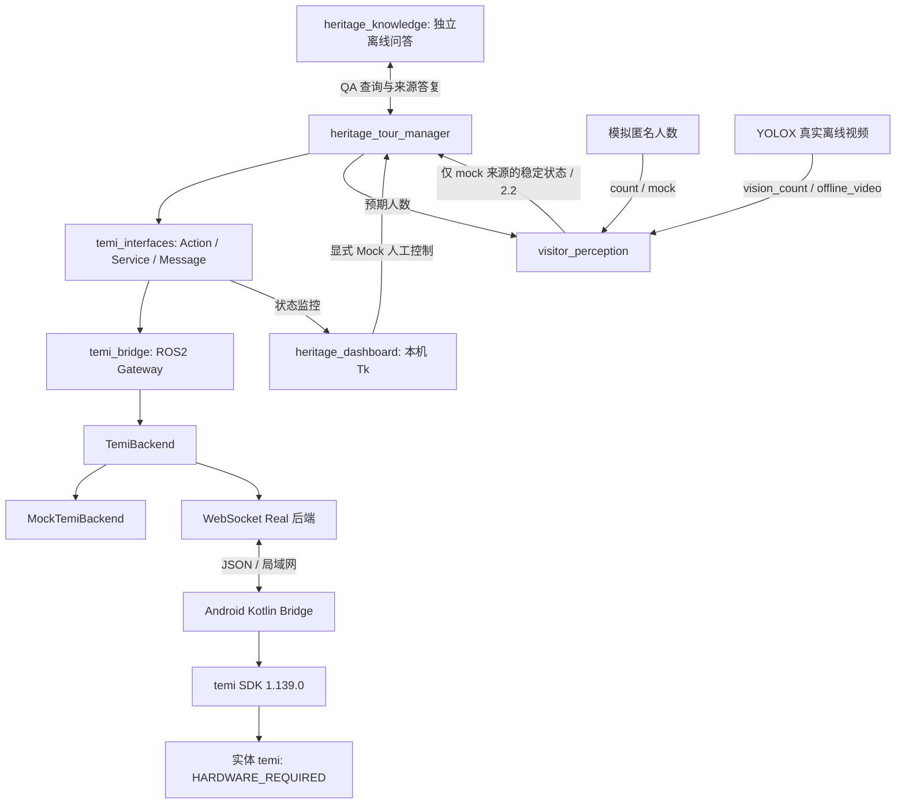
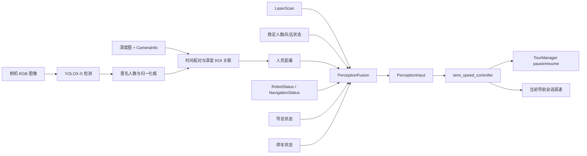

# 系统架构

## 目标与边界

在没有实体 temi 的阶段，先建立可独立运行的 Linux ROS2 Mock 导览闭环；未来获得实体机器人后，通过 Android Kotlin Bridge 接入官方 SDK。业务逻辑不依赖 Android 类或硬件 SDK。

## 模块及通信

| 模块 | 职责 |
| --- | --- |
| `temi_interfaces` | 统一 ROS2 RobotStatus、NavigationStatus、NavigateTo、Speak、StopRobot 定义 |
| `temi_bridge` | 统一后端抽象、Mock 仿真、ROS2 Action / Service / Topic、WebSocket Gateway |
| `heritage_tour_manager` | 导览状态机、路线执行、暂停/恢复/取消/异常处理、2.2 一次性游客联动（仅 Mock、默认关闭） |
| `visitor_perception` | 匿名 Mock / 离线视频 YOLOX 人数、稳定与新鲜度状态、掉队和重新集合事件（2.1–2.3 本机验收；真实传感器待验证，离线源不授权运动） |
| `heritage_knowledge` | 五主题离线问答、来源追溯、ROS2 问答 Service（3.1/3.2 本机 Mock 联动已测试） |
| `heritage_dashboard` | 本机 Tk 监控、虚拟路线、问答与 Mock 人工接管（4.1 本机测试通过，默认只读） |
| `android/temi_heritage_bridge` | WebSocket 客户端、SDK 生命周期、机器人事件与命令关联 |

## 感知到动态速度控制数据流

阶段1补充的传感器输入与控制策略关系如下。感知融合节点只发布状态，不直接调用运动服务；旧版 JSON 速度输入仍保留。

统一 Topic：`heritage/perception/fused`。live 来源标记为 `temi_sensor_fusion`，仿真标记为 `gazebo_sensor_fusion`；有效性、数据年龄、导航会话和安全状态在速度控制入口重新检查。详见[速度控制架构](speed_control_architecture.md)及[阶段1报告](phase1_report.md)。

## TemiBackend 统一契约

`temi_bridge/backend.py` 已实现独立 Python 抽象及数据模型。它不导入 `rclpy`、Android SDK 或 WebSocket 库。Mock 和未来 Linux WebSocket 代理使用同一契约；真实 SDK 动作仍只由 Android 执行。

| 方法 | 行为契约 |
| --- | --- |
| `await connect()` | 后端就绪才返回成功；可重复调用，不重复启动同一连接 |
| `await disconnect()` | 断开并终结活动任务；重连不自动重放历史命令 |
| `await navigate_to(location, timeout_sec, task_id=..., feedback=...)` | 接收唯一命令 ID 和正数超时秒数；只在到达、停止、超时、断线或其他失败时返回最终 `TaskResult` |
| `await stop()` | 立即发起运动停止，不等待导航自然结束；仅确认已停止时返回成功 |
| `await speak(text, task_id=..., feedback=...)` | 关联唯一播报命令 ID，在播报完成或失败时返回最终结果，不把 ACK 视为成功 |
| `get_status()` | 非阻塞查询最近的不可变 `RobotSnapshot`，不触发网络请求 |

- 导航一次只允许一个活动运动任务，播报一次只允许一个活动语音任务；所有命令 ID 必须非空。空地点、空文本、非法超时、未就绪和冲突任务返回明确失败原因。语音超时使用后端配置，不增加 ROS2 `Speak.Goal` 的字段。
- STOP 和导航超时终止活动导航，不等同于结束语音播报；断线终止活动的导航及语音。显式取消协程时需要先清理对应任务，再传播取消。无法联络实体机器人时不能承诺已实际停车，Android 端后续需要断线保护和实机验证。
- `NavigationFeedback` 携带 `task_id`、`target`、`status`、`description`；`SpeechFeedback` 携带 `task_id`、`status`。回调由命令协程调用，调用者须保持其非阻塞且不得抛出异常。
- 导航状态统一采用小写字符串：`disconnected`、`idle`、`start`、`calculating`、`going`、`reposing`、`complete`、`abort`、`stopped`、`timeout`。播报采用 `started`、`complete`、`error`、`not_allowed`、`canceled`；后续适配器负责映射官方 SDK 事件。
- `RobotSnapshot` 初始状态为未连接、未知电量 `-1.0`、未运动、无有效坐标系；连接丢失时不能把无运动标识视为实机已停车。状态映射 ROS2 时，业务位置取最近有效保存地点，`frame_id` 区分虚拟坐标系及真实坐标系。

抽象、类型与包安装已验证；上述运行时契约已在 Mock 后端和 Linux WebSocket 代理实现。Android SDK 适配器已编译，实体行为仍待验证。

## MockTemiBackend（已实现）

- `MockConfig.from_yaml(config/system.yaml)` 读取仅用于 `mock_map` 的虚拟地点和参数。默认速度 1.0 m/s、导航准备延迟 0.2s、更新周期 0.05s、导航故障概率 0。路径为模拟点之间的直线移动，不表示真实导航规划或避障能力。
- `MockTemiBackend.navigate_to()` 根据单调时钟计算每周期位移，连续更新 `x/y/yaw` 和电量；最终抵达时坐标精确等于目标点。播报通过定时开始/完成状态模拟，无音频输出。
- `inject_navigation_failure()` 对下次被接受的导航注入一次失败；`simulate_disconnect()` 同时终结活动导航与播报；`set_battery_percentage()` 显式注入任意 0~100 电量。用户拒绝、低电量返回等业务决策留给导览任务管理器。
- STOP 和断线执行时即释放相应活动任务槽位；旧协程通过其独立中断信号返回，身份检查禁止它覆盖新的活动任务状态。所有控制方法在同一个 asyncio 事件循环中运行，状态快照可非阻塞读取。
- `scripts/mock_backend_demo.py` 使用默认配置独立执行 `entrance → exhibit_01` 与模拟播报；`tests/test_mock_backend.py` 有 20 项运行时测试。真实 Mock 轨迹与测试记录见开发日志。

## ROS2 Gateway 与 WebSocket 代理（Linux 端）

- `TemiGatewayNode` 通过独立 asyncio 后端线程实现非阻塞状态读取和异步单任务槽位，ROS2 `MultiThreadedExecutor` 至少 4 线程；STOP 服务不等待导航完成，已接受但尚未启动的导航也会被 STOP 阻止。
- 状态及导航反馈通过标准 ROS2 对象发布；导航 ID 使用 ROS2 Action Goal UUID。反馈发布异常不应中断后端任务。接受 Goal 时记录内部 `connection_epoch`，确保断线之前尚未派发的 Goal 不会作用于重连后的新会话。
- `gateway_main.py` 读取 `config/system.yaml`，以 `--backend mock|websocket` 切换；Linux WebSocket 后端不直接调用 SDK。认证、版本、状态同步、ACK、超时、重复 ID 和心跳机制见 [通信协议](communication_protocol.md)。
- WebSocket 的 STOP 确认与目标导航终态同一步处理，避免迟到导航成功。未确认停车或语音取消时拒绝新的相关任务，直到安全恢复条件满足。默认只绑定 loopback，实体断线安全策略须 Android 实现及测试。

## Android Bridge（代码及 APK 已构建）

- `BridgeProtocol` 与 `BridgeCoordinator` 为纯 Kotlin 协议和命令状态机，严格解析、检查时间戳和命令 ID、先 ACK 再调用驱动，断开及 SDK 未 Ready 时隔离旧命令和未确认的动作。
- `WebSocketBridgeClient` 使用 OkHttp，认证、限私有 IPv4、自动重连、Ping/Pong 和连接代数；在 UI 主线程派发回调，避免旧 Socket 回调覆盖新连接。
- `SdkTemiDriver` 用官方 `Robot` 实例和监听器实现导航、停止、语音、状态观测，不调用虚构 SDK。`MainActivity` 显示网络与 Ready 状态、用于用户主动连接/断开/本地停止；离开前台关闭控制连接。STOP 的 SDK `Unit` 返回不能证明已停止，等待匹配终态和新零速度证据，实际物理安全标记 `HARDWARE_REQUIRED`。
- 18 项 JVM 测试（模拟 SDK 与实际本机 WebSocket）及 APK Debug 构建通过；尚无 Android 运行时或实体 Launcher 测试。详见 [Android Bridge](android_bridge.md)。

## 导览任务管理器（已实现）

- `TourManager` 纯 Python 状态机包含 11 个指定状态，使用独立 `TourRobot` 操作契约；`HeritageTourNode` 只通过 ROS2 Action/Service/Topic 访问 Gateway，不依赖 Android SDK 或具体 Mock 实现。
- 配置文件定义入口、五展区、互动区和出口；经过 GREETING/WAITING_CONSENT/PLANNING 后顺序执行 NAVIGATING/EXPLAINING，互动 QA 为人工等待，最终 RETURNING/COMPLETED。
- 通过本机 ROS2 Trigger 支持暂停/恢复、拒绝、掉队、取消、人工接管、QA 结束；低电量停止当前段并尝试返回配置的安全地点，失败或无法确认 STOP/Action 终态进入 ERROR。不自动重放旧 Goal。
- 实际 ROS2 Action 终态验证、通信状态 watchdog、迟到接受响应取消与未确认终止处理均已实现；物理动作的停机确认与实机语音取消仍为 `HARDWARE_REQUIRED`。
- 示例路线通过实际双进程 Mock 导览：8 站、19.505 秒、0 异常；完整 Linux 回归 81 项通过，详情见 [导览管理器文档](tour_manager.md)。

## 本轮实现原则

- Mock 模式不需要 Android 或实体机器人；移动位置随时间变化，默认不发生随机故障，测试显式注入故障。
- Real 模式只在 Android 上调用 SDK，Linux 不假装拥有真实硬件能力。按命令 ID 管理异步导航与 TTS，连接断开时禁止自动重放运动命令。
- WebSocket 控制端口默认不向公网开放，明确认证与连接状态；STOP、取消、超时和断线恢复均需要独立测试。
- 固定五展区路线基于虚拟保存地点名称，不使用虚构的真实地图坐标。
- 所有节点的包目录、安装产物和日志保持在 `ros2_ws`，使用现有 ROS2 Humble；因 Humble rosidl 中文路径兼容问题，CMake 构建缓存通过 `scripts/build_ros2.sh` 隔离在纯英文 `/tmp` 路径。Python 新依赖单独隔离，Android 构建使用 `.toolchain` 下已验证的工具链。

## 验证路线

1. 独立验证接口生成与 Python 导入。
2. 独立验证 Mock 运动、反馈、电量、断线、故障、取消与 STOP。
3. 验证 ROS2 Action、Service 和 Topic 的实际通信，再验证 WebSocket 协议及 Android APK 构建。
4. 验证固定路线从入口至出口的完整导览，并记录耗时、状态转换和失败次数。
5. 获得实体 temi 后再验证 SDK 服务就绪、真实保存地点、机器人导航、语音、传感器和安全行为（`HARDWARE_REQUIRED`）。

当前文档定义的是目标架构，不表示各模块已经实现。
