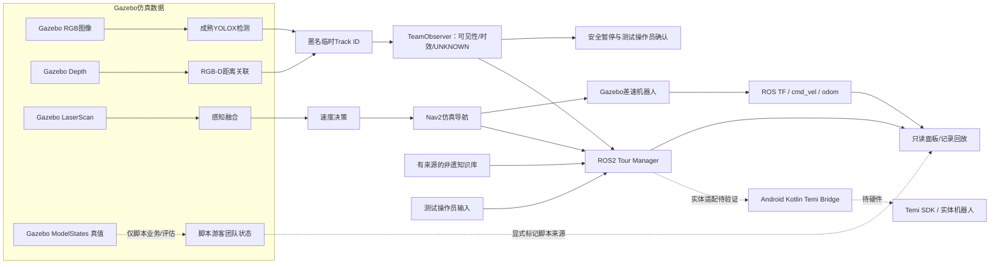

# 技术架构说明（阶段3.0证据口径）

## 已验证链路

- **T04 business_script official**：从入口同意到五区、知识库QA及出口完成；3名Gazebo脚本演员。脚本团队状态不是视觉输出。Tour `visitor-full-20261123-162126`，报告SHA `6afc1a912eeb3d95212ecdc643b071c6ad99e197b328e38dc93f1d7eb1be3f31`。
- **T04 vision_conservative**：RGB→YOLOX/RGB-D→匿名观察；前向覆盖不足时1078条观察均为UNKNOWN，6次暂停有新鲜odom停稳确认、操作员确认后完成出口。run `visitor-full-20261123-160651`。不能描述为跟踪团队成功。
- **E04**：人员检测/距离与Scan在横穿时同时有效，速度/停车和odom都记录；单传感源的因果归属未验证。
- **Nav2**只控制Gazebo仿真差速模型。实体路线计划由Android Kotlin Bridge调用Temi官方SDK保存地点导航；没有实机接入结论。
- **T08回放**展示已有记录的ROS TF、cmd_vel、odom和独立标记的Gazebo游客真值；源run未保存RGB/depth帧。RECORDED_ROS2页面是只读，本机HTTP只绑定127.0.0.1。

ROS2 Humble、Nav2、Gazebo Classic、YOLOX、OpenCV/RGB-D、Three.js和Temi SDK都是成熟组件。项目贡献是场景业务编排、来源隔离、不确定状态安全处理、会话化停止/恢复和多布局工程适配，不声称原创检测或导航算法。实体Temi、设备制动、ASR/TTS、接触安全及真实场馆地图均为`HARDWARE_REQUIRED`。
