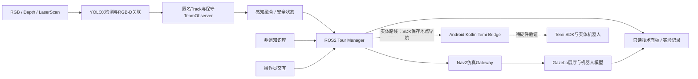

# 技术架构说明

## 数据与控制边界

- Gazebo/Nav2是仿真底盘路径；实体temi计划由Android Kotlin Bridge调用官方SDK保存地点导航。不能把Nav2的仿真cmd_vel直接描述为Temi底盘控制。
- YOLOX只从真实相机图像产生检测框。Gazebo `/model_states`是真值评估流，在业务脚本模式可用于明确标记的脚本队伍策略；视觉保守模式不消费该流。
- 速度决策、Nav2读回参数、cmd_vel、odom分开展示。控制配置值不是最终速度；只有odom真实采样才能支持仿真运动响应结论。
- 知识库答案带项目配置的来源URL；模拟播报与实体TTS分开。
- 回放与可视化为只读展示；操作员交互API单独受限，浏览器演示语音属于浏览器TTS。

## 创新与成熟组件的边界

项目贡献是导览业务、视觉不确定性处理、会话安全和多布局配置的工程集成。ROS2、Nav2、YOLOX、Gazebo和Three.js均为现成组件。阶段2.9动态视觉和多场景数据尚未完成，不能把架构图当成已运行证明。
