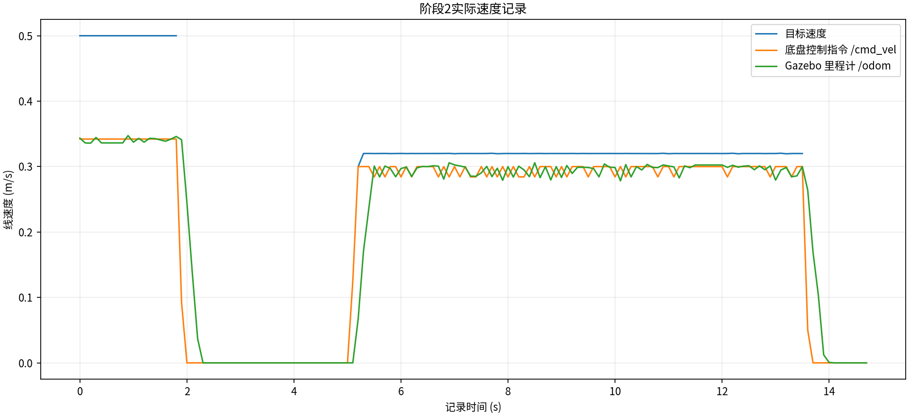
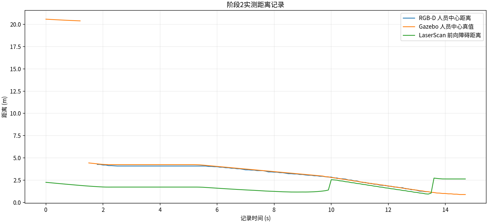

# 阶段 2.5 实验对比

## E01 基线与 E03 动态靠近

| 指标 | E01：正常完整导览 | E03：动态人物完整导览 | 解释 |
|---|---:|---:|---|
| 路线耗时 | 272.552 s | 372.008 s | E03 比 E01 多 99.456 s（36.5%）；两次运行不是受控的单变量对照，不能把全部时差归因于人物 |
| Nav2 成功目标 | 7/7 | 7/7 | 两条路线都从 wait 到 exit 完成 |
| 平均 `|cmd_vel − odom|` | 0.007 m/s | 0.017 m/s（14.70 s 人物片段） | E03 样本窗口更短、阶段不同，只描述实测差值，不代表速度跟踪性能变差 |
| YOLOX 候选帧检出 | 17/123（13.8%） | 110/117（94.0%） | 按 Gazebo 几何估计的水平视场候选；E01 入口访客多数不在相机候选区域，不能当作相同条件下的检测率对比 |
| 计数 MAE | 0.862 人 | 0.060 人 | 仅 E03 的候选视场帧有意义；未人工标注遮挡和垂直视场 |
| RGB-D 前向深度 MAE | 0.105 m（17 对） | 0.133 m（114 对） | 对最近 Gazebo 视场候选做配对，样本位置/范围不同 |
| 停车请求到确认 | 1.200 s（1 次） | 1.049 s（2 次，人物片段） | 来自 ROS 2 停车状态和新鲜 odom；不是物理制动距离 |
| 动态人物最小估算表面间隙 | — | 0.269 m | 记录器按假设支撑半径估算。人物靠近后离开视觉有效区，系统以感知无效触发 fail-safe 停车；该近距离需要继续改进 |

E01 与 E03 原始记录：[E01 报告](clean_tour/20261121-222535/experiment_report.md)、[E03 报告](dynamic_people/approaching/20261122-0008-late-stop-fix-delay8/experiment_report.md)。

## 鲁棒性对比

- **E08 传感器断流：** 在实际运行的 perception ROS 进程组中暂停发布 3.004 秒；采集记录与故障重叠 3.004 秒，融合输入失效后进入停车状态，恢复发布后重新进入恢复流程。该结果验证软件失效处理，不表示传感器硬件断电行为。
- **E09 Nav2 失败：** 实际 `NavigateToPose` 越界目标终态为 `ABORTED`；来自旧导航会话的速度命令被拒绝。测试后需人工复位错误锁存。
- **E10 人工停止：** 导览进行中调用 cancel 服务成功，停止请求至确认平均 0.900 秒，进入 IDLE 并等待人工复位，未自动恢复路线。
- **E04 横穿：** 模型服务调用没有得到可验证的 Gazebo 位姿回读，因此无法比较视觉检测、Nav2 绕行或避障；此项保留为失败。

## 结论

仿真数据支持：五区路线与 QA 的软件闭环能够完成；RGB-D 人员观察有效时速度策略能响应距离；感知失效、Nav2 失败和人工取消有软件层处理路径。动态靠近记录同时显示，相机视场丢失时仍可能形成 0.269 m 的估算表面间隙，因此还不能满足展厅部署验收。需要先修复 E04 注入、重做 E05 危险距离及 E06 离开恢复，并完成 E07 Gazebo 团队实验。
