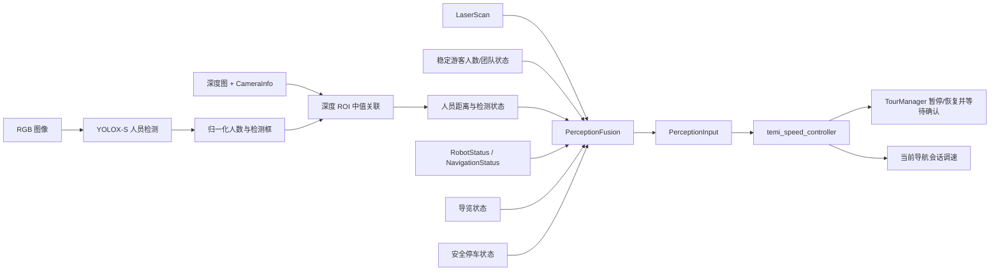

# 阶段1报告：统一感知输入与速度控制接入

日期：2026-11-21。阶段范围：完善真实传感器可用的数据接口和可验证的 ROS2/Gazebo 软件链路；没有开始阶段2。

## 数据流

## 实现内容

### 1. 统一 ROS2 接口

- 新增 `PersonDetection.msg`：归一化检测框、置信度，以及显式的距离有效标志和距离值。
- 新增 `PersonDetectionArray.msg`：样本 Header、来源、新鲜度、人数、检测列表、最近人员距离和可选标定密度。
- 新增 `PerceptionInput.msg`：来源、来源列表、单调时钟采样时间/年龄、人数和团队状态、人员与障碍距离、定位/通信/停车标志、导览/讲解状态、导航错误和当前导航会话 ID。
- `header.stamp` 表示融合消息的 ROS 发布时间；`sample_timestamp_monotonic_sec` 与 `sample_age_sec` 使用本机单调时钟，采样时间取最旧的视觉/激光样本估计值（上游提供年龄时会扣除该年龄）。不同设备的单调时钟不可跨机器比较，因此它不替代分布式时钟同步或传感器硬件时间标定。

### 2. 游客和人员检测

- 保留 `VisitorMonitor` 原有稳定采样、人数抖动抑制、掉队判断和断流语义。相机人数现在走独立 `/heritage/visitor/camera_count`；Mock 与离线视频仍使用各自输入 topic。状态暴露单调采样时间和年龄。
- YOLOX ROS 节点消费可配置 RGB topic，发布匿名人数与原始检测框；模型默认指向仓库已有 `object_detection_yolox_2022nov.onnx`。
- 深度关联根据图像时间戳配对，并使用 CameraInfo 内参；从检测框中心 ROI 取得有效深度中值，计算相机径向距离。无足够有效深度像素就标为无效，绝不按框大小估算距离。
- 相机密度仅在上游明确给出有效、0–1 范围的标定值时保留。本轮没有实现或声称完成人群密度标定。

### 3. 激光与多源融合

- `PerceptionFusion` 只取 LaserScan 前方配置扇区内有限且位于传感器有效范围的最小距离，过滤 NaN、Inf、负值、无效范围和断流。
- 融合读取稳定游客状态、人员深度结果、LaserScan、RobotStatus、NavigationStatus、导览状态和安全停车状态；不调用导览服务，也不直接控制机器人。
- live 与 simulation 来源分别标记为 `temi_sensor_fusion` 和 `gazebo_sensor_fusion`。live 模式拒绝离线视频、Mock 和 Gazebo 感知输入；模拟输入只有显式启用模拟来源才可参与速度策略。
- 未知密度是 warning，可按拥挤速度保守限速；人员距离、激光、定位、通信、停车状态、数据新鲜度或活动导航会话无效时，融合状态无效并进入已有保守停车逻辑。

### 4. 速度控制兼容

- `temi_speed_controller` 新增订阅 `heritage/perception/fused`，映射每个有效标志、来源和会话 ID 到原有 `SpeedInputs`。
- 原 `heritage/speed_control/input` JSON 输入保留，不更改原有速度限幅、加速度约束、命令节流、人工停止优先级、停车确认、错误锁存和人工复位策略。
- 停车状态仍需既有后端/导览管理器的确认；仅收到暂停请求或软件目标速度并不表示机器人已停止或已达到目标速度。

## 实际验收结果

| 验收项目 | 本轮结果 | 证据与限制 |
|---|---|---|
| ROS2 构建 | 7 个包通过，9.15s | [最终构建日志](runs/phase0-phase1-20261121/ros2_build_complete.log) |
| 完整自动化回归 | 264 passed，0 failed，0 skipped，178.73s | [完整测试日志](runs/phase0-phase1-20261121/tests_complete.log)；测试覆盖单元、Mock 与本机 ROS2 集成，不代表实体测试 |
| 感知融合 ROS2 集成 | 发布融合状态并传入速度策略用例通过 | 合成测试发布器输入；验证 Topic/API 及安全策略映射 |
| Gazebo 激光与 RGB-D | 成功接收 scan、RGB、32FC1 深度图、CameraInfo 和 TF | [传感器报告](runs/phase0-phase1-20261121/gazebo_sensors.json)；数值仅是 Gazebo 场景测量 |
| Gazebo YOLOX RGB 流 | 用仓库 ONNX 模型接收模拟 RGB 图像，ROS Topic 收到人数 `0` | [实际输出](runs/phase0-phase1-20261121/yolox_gazebo_count.log)；模拟场景没有行人，不能评估有人时准确率 |
| 融合→速度策略 Gazebo 检查 | 检查通过 | [融合报告](runs/phase0-phase1-20261121/gazebo_fusion.json) 使用明确标注的合成检测框和标定密度测试夹具；不是相机 YOLOX 输出 |
| Android 构建 | 未完成 | 在线 Google Maven 请求超时；离线缓存缺少依赖：[日志](runs/phase0-phase1-20261121/android_build_offline.log) |
| temi 实机 | 未执行 | 当前没有实体 temi 和真实传感器驱动 |

## 遗留事项

- 连接实体 RGB/深度/激光驱动，核对话题和帧坐标，完成真实内外参标定、检测距离误差测量及人群密度定义。
- 为安全停车信号和融合所需机器人/导航/导览状态提供可靠生产者；现有传感器 Topic 有效不代表安全停车已确认。缺失信号时必须保持失败关闭行为。
- 用包含行人的 Gazebo 场景或获授权录制数据测试 YOLOX 框与深度配对，再验证完整 `PerceptionInput` 的新鲜度、会话切换和速度策略。
- Android 依赖恢复后复跑 Android JVM 和 APK 构建；之后需要与 temi Launcher 做连接、动态速度、停止确认和断线恢复的受控实机验证。

详细基线、测试范围、104/237 历史记录与风险见[项目状态](PROJECT_STATUS.md)。下一阶段计划已经更新，本轮到此停止。
