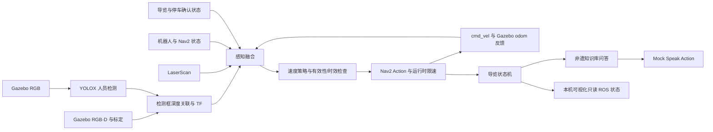
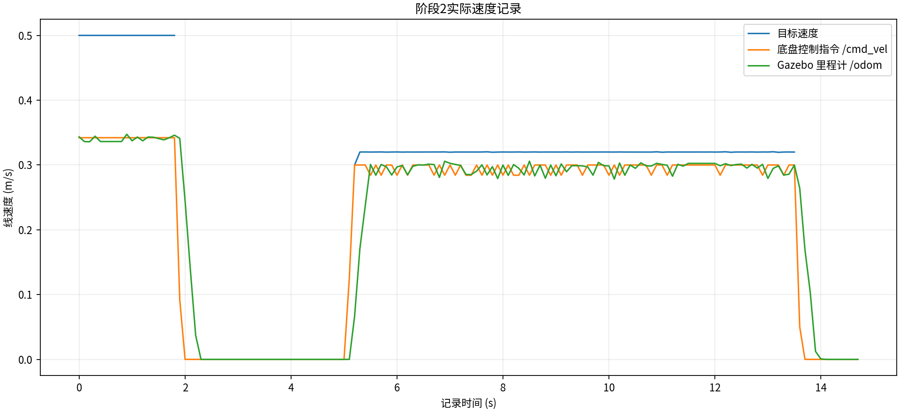
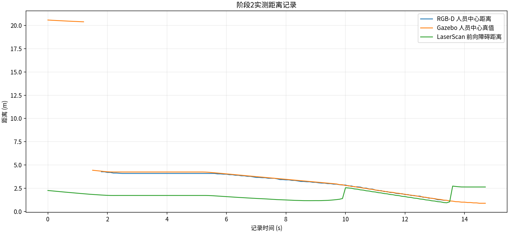

# 阶段 2.5 开发与验收报告

日期：2026-11-22
基线：`59d41bf`
范围：ROS 2 Humble、Gazebo/Nav2 和本机 Android Bridge 基线；没有实体 temi。

## 结果摘要

- ROS 2 工作区 7 个包构建通过；Python/ROS 2 全量回归 **341 passed**（180.42 秒）。阶段 2 的 314 项基线没有回退，新增 27 项。
- 一条从入口待命到出口的五区导览完整到达 `COMPLETED`，顺序为 `wait → zone_1 → zone_2 → zone_3 → zone_4 → zone_5 → exit`，7/7 个 Nav2 路段成功，`error_count=0`。其中包含实际提交的“潮州音乐有哪些类型？”问答，知识库命中并完成 Mock Speak Action；这不是实体机器人的音频播报验证。
- 动态人物实验矩阵：**4 PASS、1 PASS WITH RISK、1 FAIL、4 NOT RUN；将带风险的 E03 计为通过时为 5/10（50%）**。E03 的 Gazebo 人物确实移动并进入 RGB→YOLOX→RGB-D 感知链路，速度控制减速，并因感知失效发起安全停车；人物在 Gazebo 中距机器人中心最近约 0.883 m，对应估算表面间隙约 0.269 m，停车确认时底盘 `cmd_vel=0`。该距离很近，不能当成实机安全距离。
- E04 横穿注入未能确认模型位姿，记为 FAIL；E02、E05、E06、E07 没有合格的独立 Gazebo 实验记录，记为 NOT RUN。已保留所有失败尝试，没有将单元测试冒充集成测试。
- Android 本阶段没有源码改动。离线构建因本地 Gradle 缓存缺少 `builder-8.0.0.jar` 与 `bundletool-1.13.2.jar` 失败；在线构建尝试在 90 秒上限后被取消，未产生本阶段新 APK。阶段 2 曾有 JDK 17 的 `testDebugUnitTest` 和 `assembleDebug` 成功记录，见[阶段 2 构建记录](runs/phase2-20261121/android_build_phase2.log)。

## 本阶段实施内容

- 增加隔离启动与就绪检查：[`start_phase25_system.sh`](../scripts/start_phase25_system.sh)、[`phase25_preflight.py`](../scripts/phase25_preflight.py)。检查 ROS 域和端口、Nav2/定位/感知/导览/知识库/速度服务；启动失败和 Ctrl+C 仅清理本脚本创建的进程组。
- 扩展 Gazebo 人物注入器，支持空场、单人、三人、靠近、横穿、离开、掉队和拥挤场景；使用 Gazebo 模型位姿回读记录真值，并保留随机种子、轨迹、速度和清理信息。人物轨迹用 `/gazebo/set_entity_state` 写入仿真模型；不替代 YOLOX 视觉输入。
- 修正动态人物注入器的安全会话匹配：只接受项目 Nav2 transport 的有效停车状态，忽略旧导航会话的迟到停车事件，并允许在运行中加入的监测器从有效 CLEAR 状态学习当前会话。
- 扩展游客辅助逻辑以接受 `camera`/`temi_camera` 的稳定匿名人数以及 Gazebo `map` 帧；人数不足会请求暂停，重新集合后仍要求人工恢复。`submission_system.yaml` 仅在受控仿真中启用该功能。人物身份不会从匿名计数推断。
- 扩展记录器与分析器，记录导航会话、导览/速度状态、人数、视觉估计、激光距离、Gazebo 人物真值、`cmd_vel`、odom、停车及恢复事件，生成速度、距离和状态图。

主要改动涉及 `scripts/`、`simulation/`、`config/submission_system.yaml`、`ros2_ws/src/visitor_perception/`、`ros2_ws/src/temi_speed_controller/`、`ros2_ws/src/heritage_tour_manager/` 及其测试。Android SDK Bridge 保持原接口和代码不变。

## 导览闭环

E01 记录：[报告](experiments/phase2_5/clean_tour/20261121-222535/report.json)、[事件](experiments/phase2_5/clean_tour/20261121-222535/events.json)、[CSV](experiments/phase2_5/clean_tour/20261121-222535/experiment_data.csv)。路线耗时 272.552 秒，7/7 导航任务完成，到站前有里程计静止窗口，五个展区按顺序讲解并完成问答和出口讲解。该次出现一次安全停车确认后自动恢复；没有人工故障复位，不能称为零中断运行。

E03 动态人物全程记录：[报告](experiments/phase2_5/clean_tour/20261122-0008-e03-late-stop-fix-delay8/report.json)。路线耗时 372.008 秒，7/7 路段完成。仿真人物轨迹与真值：[truth.json](experiments/phase2_5/dynamic_people/approaching/20261122-0008-late-stop-fix-delay8/truth.json)、[监测记录](experiments/phase2_5/dynamic_people/approaching/20261122-0008-late-stop-fix-delay8/monitor.json)、[原始片段 CSV](experiments/phase2_5/dynamic_people/approaching/20261122-0008-late-stop-fix-delay8/segment.csv)。记录中视觉候选帧检出率 94.0%（110/117）、候选人数 MAE 0.060、RGB-D 前向深度 MAE 0.133 m、平均停车请求到确认 1.049 秒。候选帧由 Gazebo 模型几何投影估计，只覆盖模型中心处于水平视场及深度范围的帧，不等同于完整标注集上的 precision/recall。

## 具身感知与控制架构

实验报告分别记录 Gazebo 几何真值、相机算法估计、策略目标速度、Nav2/cmd_vel 和 Gazebo odom。真值只用于对照，不反馈到速度策略。

## 曲线与原始证据

动态 E03 曲线来自实际 ROS 2 记录，不含合成或预录制轨迹：

五区 E01 与鲁棒性实验曲线和状态变化见[实验矩阵](experiments/phase2_5/experiment_matrix.md)以及各证据目录。

## 构建和测试

| 检查 | 结果 |
|---|---|
| ROS 2 Humble 七包完整构建 | 7/7 通过，独立构建目录 `/tmp/heritage_phase25_install` |
| Python/ROS 2 完整回归 | **341 passed，180.42 秒**；含 Gazebo 场景生成、感知融合、速度策略、安全停车、导览和游客辅助测试 |
| Android 离线构建 | 未能启动编译，Gradle 离线缓存缺少两项 AGP 依赖；Android 源码未改 |
| Gazebo/Nav2 完整导览 | E01 和 E03 通过，均按真实 Nav2 Action 逐站到达；Speak 使用 Mock Action |
| 实体 temi | 未验证；无设备 |

详细矩阵、指标与对比见[experiment_matrix.md](experiments/phase2_5/experiment_matrix.md)、[metrics_summary.csv](experiments/phase2_5/metrics_summary.csv) 和[comparison_report.md](experiments/phase2_5/comparison_report.md)。

## 限制与待办

1. E04 横穿的 Gazebo 位姿回读失败，需要修复横穿场景触发窗口和模型确认，再重新做有 YOLOX 参与的试验。
2. E02 人群增加、E05 单独危险距离、E06 离开恢复、E07 Gazebo 团队掉队与重新集合未完成。游客辅助只有匿名人数；重新出现同样人数不能证明原来那个人返回。
3. E03 最小估算表面间隙为 0.269 m。当前视觉链路在人物靠近后丢失视场并触发失效停车；需要改善相机视场内跟踪和停车提前量，再重复测量，不能据此声称已达到真实展厅安全距离。
4. Nav2/Gazebo 和 `Mock Speak Action` 不证明实体 temi 的速度控制、物理制动、真实 TTS、摄像头标定或游客隐私现场流程。获取设备后仍需受控场地联调及人工急停验证。
5. 未提交 Git，也未推送 GitHub。
