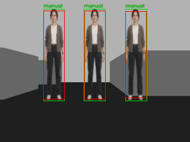

# WP01-GAZEBO-CAMERA-04：真实 RGB-D 图像与匿名跟踪采样

## 结论

**PASS_WITH_RISK，仅限静态相机感知冒烟。**这轮保存了真实 Gazebo RGB 和深度帧，直接采集 YOLOX、深度关联、匿名跟踪与团队观察器输出。它不证明移动游客跟随或完整导览闭环。

## 实测结果

- 官方展厅，3 个 Gazebo 人形模型静止，seed 282；机器人未发送导航目标。
- 15 秒采集窗保存 12 张 320×240 RGB 帧、5 张 32FC1 深度帧；CameraInfo 的 RGB/Depth frame_id 一致，内参 `fx=fy=277.127`。
- YOLOX 发布 46 条原始检测，其中 46 条有效；发布吞吐约 **3.06 条/秒**。这是消息吞吐，不是控制好的模型推理 FPS；模型推理 FPS **NOT_COMPUTABLE**（未采集模型推理边界的逐次耗时）。
- 对代表帧 [`rgb_06.png`](../../../../artifacts/phase2_8/raw/WP01-GAZEBO-CAMERA-04/rgb_06.png) 进行一次独立人工框标注：可见人数 3，检测人数 3，绝对人数误差 0；在 IoU≥0.5 下 TP=3, FP=0, FN=0, Precision=1.000, Recall=1.000, mean IoU=0.923。样本只有 1 张图，不能解释为通用准确率。
- RGB-D 关联输出 138 条有效距离，范围 3.047–3.141 m。没有独立真值表面深度；Gazebo 模型中心距不能等同于图像里躯干表面距离，因此深度误差 **NOT_COMPUTABLE**。
- 匿名跟踪输出 47 条消息，每条观察到 3 个轨迹；该静态窗口 ID 集合保持不变。没有逐帧人工身份关联，ID switch **NOT_COMPUTABLE**。
- 团队观察器 47 条输出均为 `UNKNOWN`。本轮未发布游客已同意的 `expected_count`，且单前向相机不能证明全队覆盖；因此这是保守结论，不代表已完成掉队识别。
- 收尾时两个本轮进程组均退出，最终 ROS domain 232 空图；没有修改其他域或进程。关闭日志中感知子节点均报告 cleanly finished，没有本轮先前观察到的 context-invalid traceback。

## 可视化核验

[人工标注 JSON](manual_annotations.json) · [机器可读摘要](summary.json) · [实验清单](manifest.json) · 原始 RGB-D、模型真值及 ROS 输出见 [`artifacts/phase2_8/raw/WP01-GAZEBO-CAMERA-04/`](../../../../artifacts/phase2_8/raw/WP01-GAZEBO-CAMERA-04/)。已将 30 个原始文件归档至 [`WP01-GAZEBO-CAMERA-04.tar.gz`](../../../../artifacts/phase2_8/archive/WP01-GAZEBO-CAMERA-04.tar.gz)，SHA256 `c6d55b3144e3b64a4e13896e653b2c622b9606de897768fd5ad0e57e8e7ca064`；逐文件校验结果见 [`archive_integrity.json`](archive_integrity.json)。

## 限制

本轮没有移动、遮挡、离开视场、重新入场、Tour Manager 暂停/恢复或后向观察。Precision/Recall 是单帧小样本；深度误差和 ID switch 不可计算；完整视觉队伍导览仍为 NOT_RUN。
