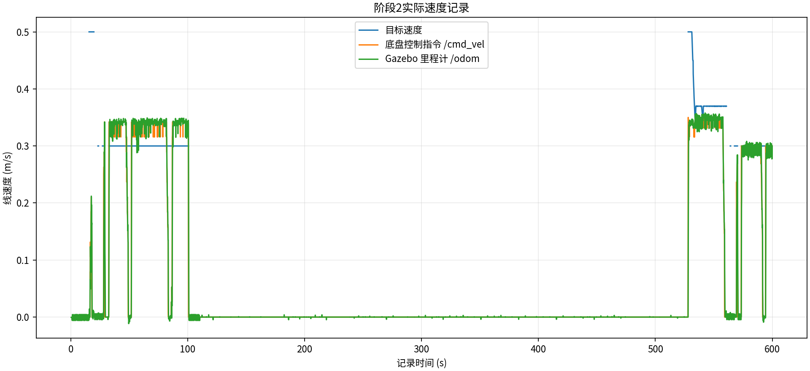
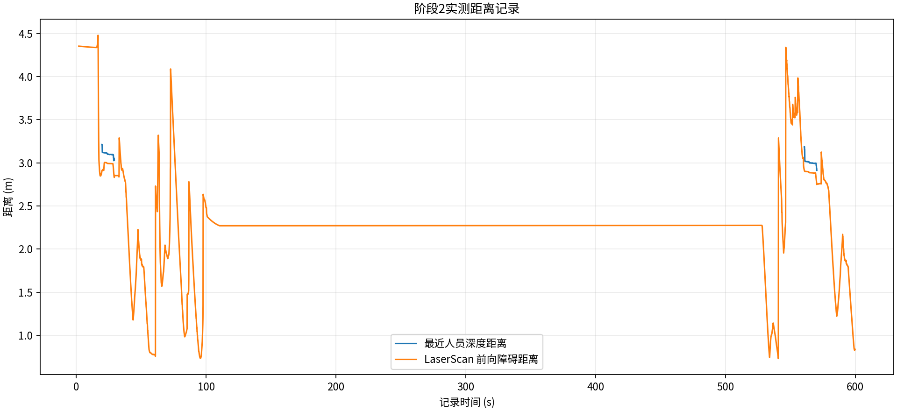

# 阶段2报告：具身感知与动态速度控制闭环

日期：2026-11-21
基线：main，提交 721ef72
验证环境：Ubuntu 22.04、ROS 2 Humble、Gazebo Classic、Nav2；没有实体 temi。
工作树：本轮修改未提交、未推送。

## 结论

阶段2的软件链路已完成并在 Gazebo 中进行了闭环验证：有效空场不会被误判为传感器故障；真实 YOLOX-S ONNX 对仿真人物模型产生检测，检测框与相机深度关联后进入融合和速度控制；速度控制通过 Nav2 控制器及速度平滑器的运行时参数限制影响后续 cmd_vel，Gazebo 里程计也记录到相应运动。停车确认结合导航终态与新鲜里程计静止反馈。官方五区路线最终到达 COMPLETED，visited 序列包含五个展区和出口。

实验过程中确实出现过停车后导航状态误分类、启动阶段安全状态锁存和 LaserScan 正无穷回波处理问题；均已修复并加入回归测试。首次长记录还包含旧版本失败、人工复位及重启后的运行片段，不能当作一条无中断的干净路线。最终出口段记录显示在人工确认传感器、导航和停车条件后清除锁存、恢复原出口任务并完成路线。

这些结果是仿真和软件验证，不证明真实 temi 的速度控制、制动距离或现场安全。人物横穿、游客掉队、动态靠近的完整运动实验和运行中人工急停场景尚未全部实测。知识问答状态曾在导览中进入，但本轮没有提交实际游客问题；超时后继续返回出口，不能宣称答案播报已验证。

## 变更内容

- 感知接口新增明确的人员观测状态与可信停车状态消息；融合区分有效空场、人员距离有效、人员距离未知和传感器无效。
- 深度关联检查 RGB、深度图、CameraInfo 的时间、帧和尺寸，并处理置信度与过期数据；空检测只在相机输入新鲜有效时表示有效空场。
- LaserScan 的空数组、NaN、负无穷、过期和非法元数据仍失败关闭；有效前向射线全为正无穷时，以量程上限表示无近距离回波，不伪造障碍物。
- Nav2 停止确认绑定当前导航 UUID、Action 终态和新鲜静止里程计；将已确认取消与异常终止区分，防止旧导航状态影响新任务。
- 速度控制增加有效导航会话门控、故障锁存和会话恢复时重新下发初始速度限值。
- Nav2 动态调速同时设置并读取核对 FollowPath 的 max_vel_x、max_speed_xy，以及 velocity_smoother 的 max_velocity；部分更新失败时回滚。
- 新增官方展厅可生成的单人和三人静态 Gazebo 人物模型场景；使用真实 YOLOX-S ONNX 推理，不注入伪造检测框。
- 新增 ROS Topic 采集、分析脚本和人物场景脚本；保留历史实验数据，输出 CSV、速度/距离图和状态变化 JSON。
- 新增/更新 ROS 接口、感知、速度控制、Nav2 后端、实验记录分析和人物场景测试。

主要代码涉及：
ros2_ws/src/temi_interfaces、visitor_perception、temi_speed_controller、temi_bridge；
scripts/start_nav2_gateway.py、scripts/start_submission_tour.sh、scripts/record_phase2_topics.py、scripts/analyze_phase2_recording.py、scripts/spawn_people_scenario.py；
simulation/models/person_mannequin；tests/ 下的感知、停车、速度、记录分析和场景测试。

## 感知数据流

~~~mermaid
flowchart LR
  RGB[Gazebo RGB] --> Y[YOLOX-S ONNX]
  Y --> D[带时间戳的人体检测]
  DEPTH[深度图] --> A[RGB-D 深度关联]
  INFO[CameraInfo 与 TF] --> A
  D --> A
  A --> P[人员观测状态与距离]
  SCAN[LaserScan] --> F[多源感知融合]
  P --> F
  ROBOT[机器人与导航状态] --> F
  TOUR[导览状态] --> F
  STOP[停车确认：导航 UUID、Action 终态、新鲜静止里程计] --> F
  F --> INPUT[PerceptionInput]
  INPUT --> POLICY[动态速度控制策略]
~~~

## 导航与速度控制

~~~mermaid
flowchart LR
  TOUR[五区导览任务] --> NAV[Nav2 导航目标与会话 UUID]
  NAV --> BACKEND[Nav2 后端与动态参数传输]
  POLICY[融合感知与速度策略] --> BACKEND
  BACKEND --> LIMIT[FollowPath 与 velocity_smoother 限值]
  LIMIT --> CMD[cmd_vel]
  CMD --> GZ[Gazebo 差速底盘]
  GZ --> ODOM[odom 反馈]
  NAV --> TERMINAL[Action 终态]
  ODOM --> CONFIRM[绑定会话的停车确认]
  TERMINAL --> CONFIRM
  CONFIRM --> POLICY
~~~

### 实测结果

主采集记录：
[experiment_data.csv](experiments/phase2/run-20261121-fixed-five-zone/experiment_data.csv)；
[速度曲线](experiments/phase2/run-20261121-fixed-five-zone/speed_curve.png)；
[距离曲线](experiments/phase2/run-20261121-fixed-five-zone/distance_curve.png)；
[状态变化](experiments/phase2/run-20261121-fixed-five-zone/state_transitions.json)。

- 主记录采样 5,998 行，时长 599.90 秒。目标速度范围 0.30–0.50 m/s；实际 cmd_vel 线速度最高 0.35 m/s，odom 线速度最高约 0.358 m/s。控制指令和里程计速度绝对差平均 0.003 m/s。
- 运行时将 Nav2 速度上限设置并读回为 0.30 m/s；对应记录中 cmd_vel 约 0.284–0.300 m/s、odom 约 0.278–0.301 m/s。原始参数与 odom 读数均核对，不能只凭 SetParameters 成功响应判断调速生效。
- 主记录里出现 7 次停车请求及确认，分析得到请求至确认平均约 1.029 秒。确认依据是当前导航任务终态和新鲜里程计持续静止，不是取消请求或速度设零本身。
- 激光前向距离记录约 0.731–4.479 m；最终出口段有效全正无穷回波按 LaserScan 12 m 量程上限处理。该值表示传感器量程内无回波，不是测得的远处物体距离。
- 路线中的人员距离样本约 2.914–3.214 m，记录到 483 个检测置信度样本；有效空场样本继续标记 NO_PERSON_OBSERVED。人员距离没有做经过标定的准确度结论。
- 出口恢复记录：[CSV](experiments/phase2/run-20261121-exit-clear-scan/experiment_data.csv)、[报告](experiments/phase2/run-20261121-exit-clear-scan/experiment_report.md)、[速度曲线](experiments/phase2/run-20261121-exit-clear-scan/speed_curve.png)。该 179.90 秒片段记录了 PAUSED/ERROR、人工复位后 RETURNING 和最终 COMPLETED；其中机器人停留时段的速度为零附近。
- 五区导览最终状态为 COMPLETED，当前位置 exit，visited 为 wait、zone_1 至 zone_5、exit，error_count 为 0。已单独确认路线经过各区并完成返回。主 600 秒记录本身结束于继续导航状态；完成证据还包括独立出口段记录和最终状态，不应把主 CSV 单独描述为全程完整记录。

### Gazebo 人物与 RGB-D 验证

- 空场：ONNX 推理节点持续接收 Gazebo RGB 帧并输出 0 人；新鲜图像使人员观测为有效空场，不再因检测数组为空而将整路感知判为无效。
- 单人静态场景：Gazebo 生成带碰撞体和可见纹理的人物模型；真实 YOLOX-S 推理得到约 0.90 置信度检测，RGB-D 关联最近距离约 2.849 m。模型中心指令位置与相机看到的人体表面不是同一测量点，不能据此报告距离误差精度。
- 三人静态场景：模型中心坐标由 Gazebo 生成脚本记录；YOLOX 实测得到 3 个关联检测，置信度约 0.917、0.905、0.886，最近关联距离约 3.047 m。命令模型位姿只是场景真值，不是算法输出。
- 使用的视觉算法为仓库 ONNX 模型，场景来自 Gazebo，不是实景视频。横穿轨迹样本为空；本轮没有完成行人横穿与机器人移动交互测评。

### 验证覆盖矩阵

| 场景 | 结果 | 证据与边界 |
|---|---|---|
| 新鲜有效空场 | 通过 | YOLOX 输出 0；融合仍有效并允许策略计算，激光安全约束保留 |
| 单人、三人视觉检测 | 通过（静态） | YOLOX-S ONNX 实际推理并做 RGB-D 关联；未验证横穿运动 |
| RGB-D 时序/帧/标定异常 | 自动化覆盖 | 回归测试拒绝不匹配、过期和无效输入 |
| 激光断流与非法数据 | 自动化覆盖 | 失败关闭；实测全正无穷按有效量程上限语义处理 |
| 空旷巡航及速度限值生效 | 通过 | Nav2 参数读回、cmd_vel 和 odom 反馈对照 |
| 障碍减速与停车确认 | 部分通过 | 主运行有 7 次安全停车确认；不是针对 10 个独立场景逐项计分的实验 |
| 障碍清除后恢复 | 通过（人工监督） | 确认感知、导航和停车条件后人工清除故障锁存，沿当前出口任务恢复 |
| 五区导览 | 通过（Gazebo） | 最终 COMPLETED；曾发生失败锁存并经人工复位后继续 |
| 游客掉队、人物逐渐靠近/横穿 | 未完整实测 | 静态人物有检测和距离样本；无移动人物闭环测评 |
| 感知断流恢复、运动中人工急停 | 自动化/部分覆盖 | 安全失败路径有软件测试；未做完整 Gazebo 故障注入矩阵 |
| 知识问答答案播报后恢复 | 未验证答案 | 路线进入问答等待并超时，未发送真实问题；问答流程不能据此验收 |
| 实体 temi 运动与制动 | 未测试 | 没有实体 temi，不能推出硬件结论 |

## 构建与自动化测试

- ROS 2 工作空间：7 个包构建通过，最终构建用时 53.8 秒；日志为 docs/runs/phase2-20261121/build_clear_scan_fix.log。
- Python/ROS 2 完整回归：314 passed，198.91 秒；日志为 docs/runs/phase2-20261121/tests_final_final.log。
- Android：本机 JDK 17 下 testDebugUnitTest 与 assembleDebug 成功；APK 为 android/temi_heritage_bridge/app/build/outputs/apk/debug/app-debug.apk。没有修改官方 temi SDK，也未在实体设备安装验证；日志为 docs/runs/phase2-20261121/android_build_phase2.log。

## 已知限制与下一步

1. 取得实体 temi 后，在可人工急停的受控场地验证 SDK 速度接口、状态回调、真实停止和制动距离；之后才可评估现场导览。
2. 标定实体相机内外参、深度偏差、LaserScan 坐标变换及各区域安全阈值。
3. 增加可重复的 Gazebo 行人移动/横穿、靠近、离开、掉队场景；按任务要求逐项记录十类速度控制与异常实验，不将软件单测替代运行实验。
4. 做一次清洁隔离的完整路线记录，避免首次错误和人工复位片段混入；同时提交实际问答内容，验证问答期间停稳、播报结束再继续。
5. 对本报告中的仿真速度与安全结论，不能外推到实体 temi 或展厅现场。
